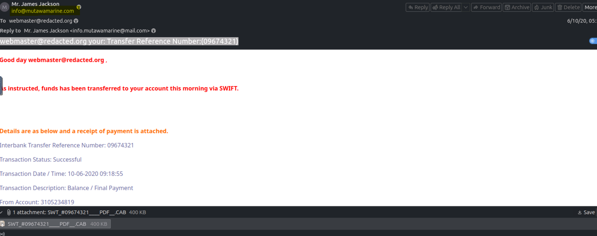
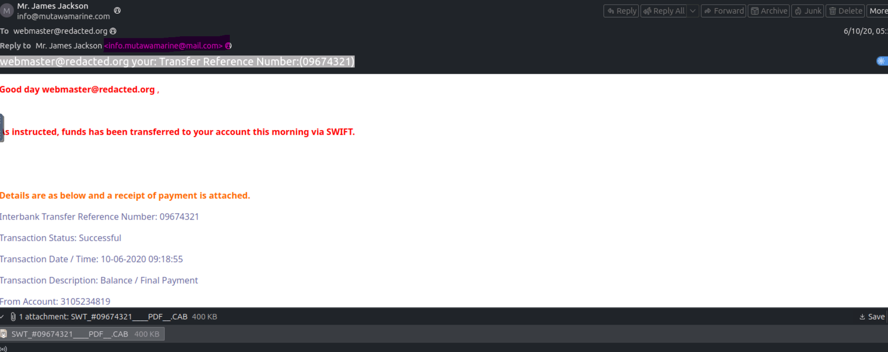
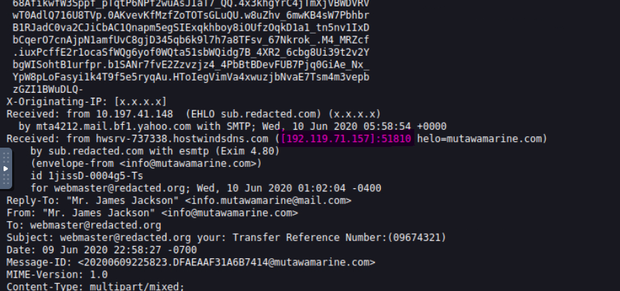
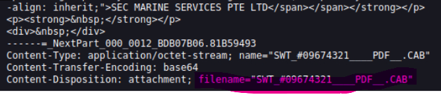

# TryHackMe Write-up: The Greenholt Phish

This repository contains my walkthrough for the **The Greenholt Phish** room on TryHackMe.

**Lab Link:** https://tryhackme.com/room/phishingemails5fgjlzxc

---

# Challenge Walkthrough

## Question 1

### What is the Transfer Reference Number listed in the email's Subject line?

### Solution

Open the provided `challenge.eml` file in the TryHackMe AttackBox (or any compatible email client such as Thunderbird).

Once the email is loaded, the **Subject** field contains the required **Transfer Reference Number**.


---

## Question 2

### What is the display name of the sender?

### Solution

The sender's display name is visible at the top of the email in the Thunderbird mail client.


---

## Question 3

### Continue investigating the email headers. What is the sender's email address?

### Solution

The sender's email address can be found directly below the sender's display name in the email view. It is also available in the email headers.



---

## Question 4

### What email address will receive a reply to this email?

### Solution

Inspect the **Reply-To** header of the email.

A useful phishing indicator here is that the **Reply-To** domain differs from the sender's email domain, which is a common tactic used in phishing campaigns.



---

## Question 5

### Begin analyzing the message source. What is the originating IP address of this email?

### Solution

Open the **Message Source** and examine the email headers.

Initially, this can be confusing because:

- The originating header appears empty.
- Multiple IP addresses are listed.
- Two of the IP addresses belong to the private `10.x.x.x` address range and therefore are not the public sender.

The correct answer is the public IP address listed alongside the mail server information.



---

## Question 6

### Investigate the IP address from the previous question. Who is the owner of the originating IP?

### Solution

Perform a WHOIS lookup on the public IP address (without the port number).

One easy way to do this is by using:

https://www.whois.com/whois/

Enter the IP address, and the ownership information will be displayed.

---

## Question 7

### Run an SPF record check on the Return-Path domain identified in the email headers. What is the full SPF record for this domain?

### Solution

Identify the **Return-Path** domain from the email headers.

In this challenge, the domain is:

```
mutawamarine.com
```

Use an SPF lookup tool such as:

https://dmarcian.com/spf-survey/

Search for the domain to retrieve the complete SPF record.

---

## Question 8

### Perform a DMARC lookup for the Return-Path domain found in the email headers. What is the complete DMARC record for this domain?

### Solution

Use the same Return-Path domain identified previously.

Perform a DMARC lookup using:

https://dmarcian.com/domain-checker/

The tool will return the complete DMARC record.

---

## Question 9

### What is the file name of the attachment found in the email?

### Solution

Inspect the attachment headers or simply view the attachment in the email client.

The filename is visible in the attachment metadata.



---

## Question 10

### Download the attachment to your virtual environment. Using the `sha256sum` command, what is the SHA256 hash of the file?

### Solution

Download the attachment to the AttackBox.

Open a terminal and execute:

```bash
sha256sum <filename>
```

Replace `<filename>` with the actual attachment name.

The command outputs the SHA256 hash required for the answer.

---

## Question 11

### What is the attachment's file size in KB?

### Solution

Upload the attachment (or search using its SHA256 hash) on **VirusTotal**.

Navigate to the **Details** tab, where the file size is displayed in kilobytes (KB).

---

## Question 12

### What is the actual file type of the attachment?

### Solution

Using the same **VirusTotal** report, open the **Details** tab.

VirusTotal identifies the true file type regardless of the file extension, making it easy to determine the actual format of the attachment.

---

# Key Learning Points

This room demonstrates several important phishing investigation techniques:

- Examining email headers
- Identifying sender spoofing
- Investigating Reply-To discrepancies
- Finding the originating IP address
- Performing WHOIS lookups
- Validating SPF records
- Checking DMARC policies
- Analyzing email attachments
- Calculating SHA256 hashes
- Using VirusTotal for malware investigation